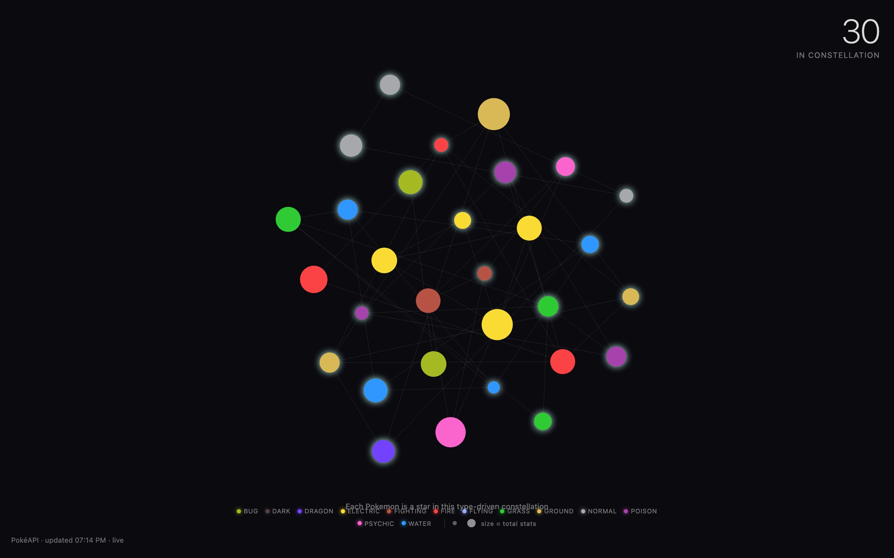
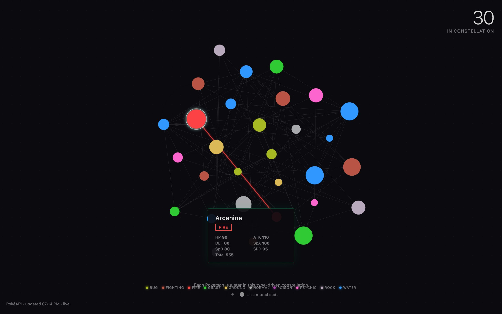

<div align="center">

<h1>TYPE</h1>

<p><b>Thirty Pokémon as a constellation of stars.</b></p>

<p><i>Each load pulls a random run of 30 Pokémon from PokéAPI. Colour is type, size is strength, and lines join every pair that shares a type.</i></p>

<h6>


</h6>

<a href="https://parthchandak02.github.io/type/"><b>Live demo</b></a> ·
<a href="#how-it-works"><b>How it works</b></a> ·
<a href="#tap-a-star"><b>Tap a star</b></a> ·
<a href="#run-it"><b>Run it</b></a>

<br><br>

<a href="https://parthchandak02.github.io/type/"></a>

<sub>Local capture, 22 October 2026. Real PokéAPI data; the batch is random on every load.</sub>

</div>

<br>

TYPE is a single HTML page that draws a batch of Pokémon as glowing circles on a dark dot grid.
On load it picks a random offset among the first 1,025 Pokémon, fetches 30 in a row from
[PokéAPI](https://pokeapi.co/) and lays them out on a golden-angle spiral. Type families show up
as clusters of colour tied together by faint lines. No API key, build step or library is needed.

## How it works

| PokéAPI field | Drives |
|---|---|
| `types` (primary) | Star colour, from a fixed 18-colour type palette, with a slight shift by Pokédex number |
| sum of `stats[].base_stat` | Star radius: 5 px at a total of 180, 30 px at 720 |
| `types` (any) | A line between every two Pokémon that share a type |
| number fetched | The count in the top-right |

The stars breathe between 0.8 and 1.2 times their size and the whole field drifts slowly. The
legend lists only the types present in the current batch. The data is fetched once per page
load; reload for a new set. If PokéAPI can't be reached, ten well-known Pokémon are used and the
stamp in the bottom-left reads `fallback` instead of `live`.

## Tap a star

<div align="center">



<sub>A focused star. Its type links light up in the type's colour. Real PokéAPI data.</sub>

</div>

Clicking a star enlarges it, highlights its links in its type colour and opens a panel with its
name, types and six base stats. The panel fades after three seconds; clicking empty space clears
the focus.

## Run it

```bash
git clone https://github.com/parthchandak02/type.git
cd type
python3 -m http.server 8000   # then open http://localhost:8000
```

Everything tunable (palette, type colours, star size and stat ranges, batch size, drift, timings)
is in the `C` object at the top of the script. `brief.md` holds the original creative brief.

<br>

<div align="center">
<sub>Built with the Canvas 2D API. Data from PokéAPI.</sub>
</div>
